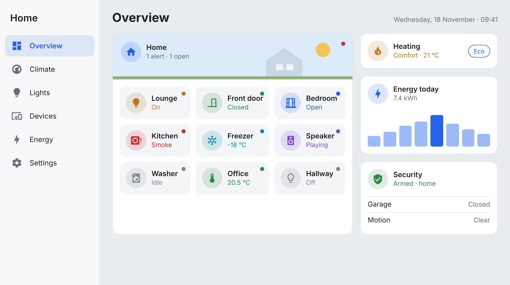
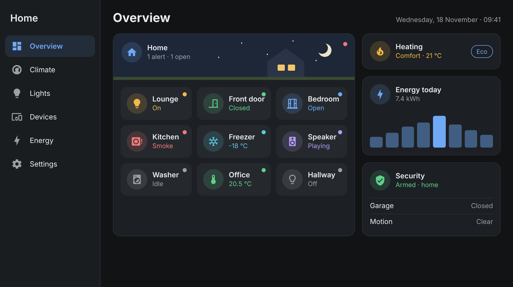
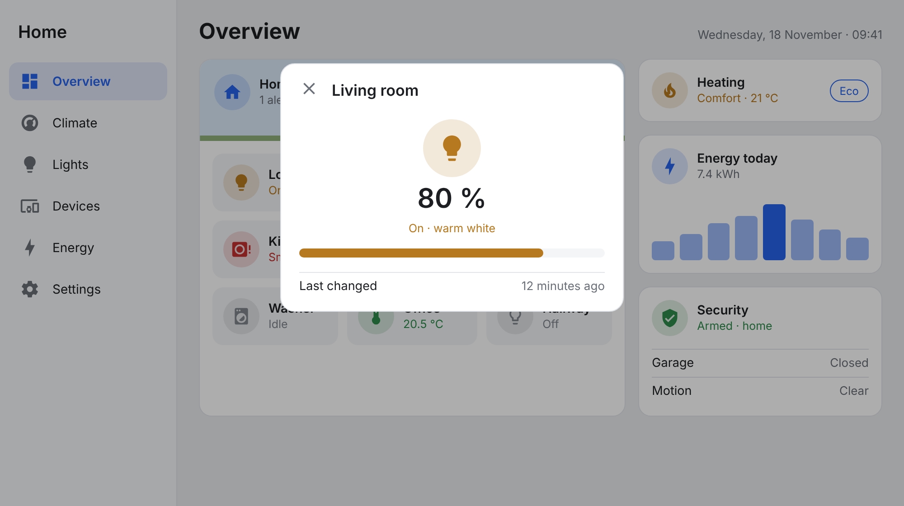
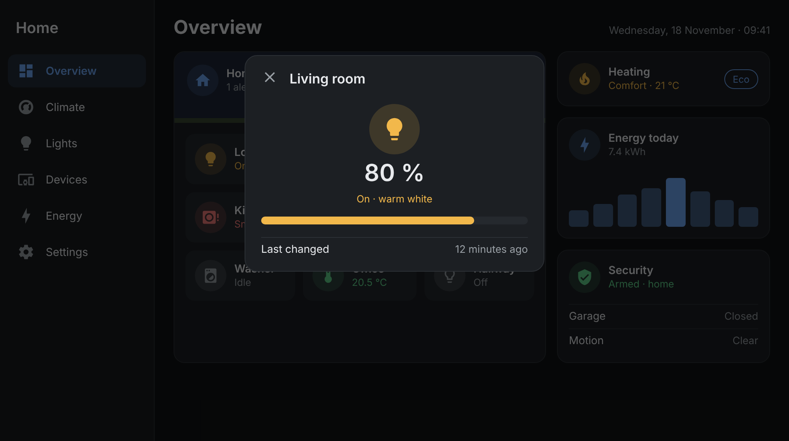

# ha-neutral

[](https://www.home-assistant.io/integrations/marketplace/)
[](https://github.com/juju35/ha-neutral/actions/workflows/hacs.yml)
[](https://github.com/juju35/ha-neutral/actions/workflows/validate.yml)
[](https://github.com/juju35/ha-neutral/releases/latest)
[](https://github.com/juju35/ha-neutral/blob/main/LICENSE)
[](https://buymeacoffee.com/julienstep9)

<p align="center"></p>

A calm, **neutral** theme for Home Assistant, in **light and dark**, designed to match the ha-* cards: flat gray page, clean opaque cards with a hairline border, soft gray inner tiles, and a **status palette** that does the talking — green when all is fine, amber when something is on, blue when something is open, red when something needs attention.

[](https://my.home-assistant.io/redirect/marketplace_repository/?owner=juju35&repository=ha-neutral&category=theme)

| Light | Dark |
|---|---|
|  |  |

Dialogs use the same opaque card surface over a dimmed dashboard, so they stay easy to read.

| Light | Dark |
|---|---|
|  |  |

## Features

- **Neutral surfaces**: flat gray page, white (light) or charcoal (dark) cards, soft gray inner tiles — no tint, no gradient, no shadow, so the color is left to what matters.
- **Status palette** shared with the ha-* cards and applied to Home Assistant's color variables, so built-in cards and state colors follow it too:

  | Meaning | Color |
  |---|---|
  | OK, presence | green |
  | Active, heat | amber |
  | Open, flow | blue |
  | Cold | cyan |
  | Media | purple |
  | Alert | red |
  | Idle | gray |

- **Light and dark** modes in one theme (`modes:`). The ha-* illustrated headers follow the theme: dark mode shows their night scene.
- 14px rounded cards with a hairline border, calm app header and side panel, blue accent on the selected item.

## Prerequisites

Home Assistant 2024.1 or later.

## Installation

### Via the Marketplace (recommended)

Click the button below to add the repository directly:

[](https://my.home-assistant.io/redirect/marketplace_repository/?owner=juju35&repository=ha-neutral&category=theme)

Then click **Download**, and restart Home Assistant.

Or manually:

1. Open **Settings → Marketplace → Add from link** (top right; this needs a GitHub account connected)
2. Add `https://github.com/juju35/ha-neutral` — Type: **Theme**
3. Open **Neutral** and click **Download**
4. Restart Home Assistant

The Marketplace copies the theme to `/config/themes/`.

### Manual

1. Copy `themes/neutral.yaml` into your `config/themes/` folder.
2. Make sure `configuration.yaml` loads the themes folder:
   ```yaml
   frontend:
     themes: !include_dir_merge_named themes
   ```
3. Restart Home Assistant.

## Usage

1. Open your **Profile** (bottom left).
2. Under **Theme**, choose **Neutral**.
3. The **Auto** / **Light** / **Dark** switch next to it selects the mode; **Auto** follows your system.

Applied per user, the choice is remembered on the device. To set it on a dashboard or for everyone, use the `frontend.default_theme` option or a `theme:` on a view.

## How it works

The theme ships a single file, `themes/neutral.yaml`, defining one theme (`Neutral`) with a `modes:` block for `light` and `dark`. It sets Home Assistant's own theme variables:

- surfaces: `primary-background-color`, `lovelace-background`, `card-background-color`, `ha-card-background`, `secondary-background-color` (inner tiles), `ha-dialog-surface-background`;
- shape: `ha-card-border-radius`, `ha-card-border-color`, `ha-card-box-shadow: none`;
- text, `app-header-*` and `sidebar-*` colors, and the blue accent (`primary-color`);
- the color palette (`green-color`, `amber-color`, `blue-color`, `cyan-color`, `purple-color`, `red-color`, `grey-color`…) and `success` / `warning` / `error` / `info` colors, which Home Assistant derives its state colors from.

Every built-in card and most custom cards inherit the look without per-card configuration.

## License

[MIT](LICENSE)
